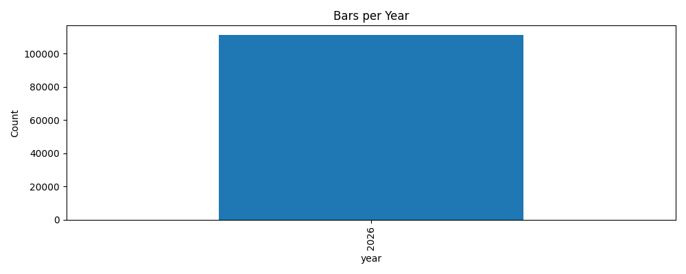
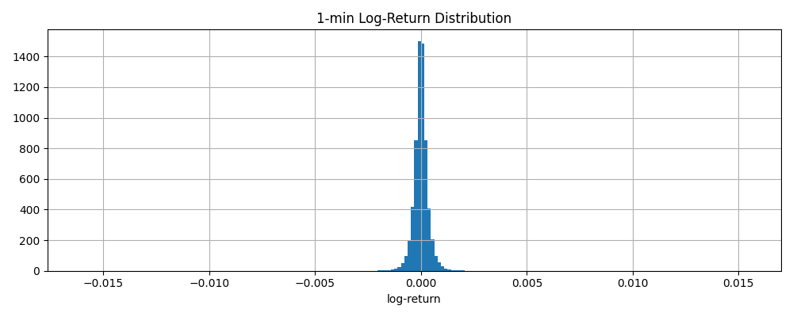

# Data QC Report — TEGF-XAU
**Generated from**: `data/raw/xauusd_1m.csv`
**Total clean bars**: 683,609
**First bar (UTC)**: 2024-10-14 09:00:00+00:00
**Last bar (UTC)**: 2026-10-14 09:59:00+00:00

## Bars per Year
| Year | Bars | Missing-min Rate |
|------|------|------------------|
| 2024 | 73,313 | 79.8% |
| 2025 | 345,287 | 4.8% |
| 2026 | 265,009 | 27.0% |

## Largest Gaps (top 20, excluding weekends)
| Time | Gap (min) |
|------|----------|
| 2026-07-15 10:00:00+00:00 | 6901 |
| 2026-05-26 04:00:00+00:00 | 4741 |
| 2025-09-02 04:00:00+00:00 | 4741 |
| 2026-09-08 04:00:00+00:00 | 4741 |
| 2026-02-02 18:00:00+00:00 | 4441 |
| 2025-04-20 22:00:00+00:00 | 4381 |
| 2026-04-05 22:00:00+00:00 | 4381 |
| 2026-07-05 22:00:00+00:00 | 3961 |
| 2026-06-21 22:00:00+00:00 | 3961 |
| 2025-07-14 04:00:00+00:00 | 3301 |
| 2026-01-19 04:00:00+00:00 | 3241 |
| 2025-07-06 22:00:00+00:00 | 3181 |
| 2025-11-30 23:00:00+00:00 | 3151 |
| 2024-12-01 23:00:00+00:00 | 3151 |
| 2025-07-28 00:00:00+00:00 | 3061 |
| 2025-11-02 23:00:00+00:00 | 3001 |
| 2024-11-03 23:00:00+00:00 | 3001 |
| 2025-02-02 23:00:00+00:00 | 2941 |
| 2025-08-10 22:00:00+00:00 | 2941 |
| 2026-07-26 22:00:00+00:00 | 2941 |

## Return Distribution by Year
| Year | Mean(r) | Std(r) | Kurtosis(r) |
|------|---------|--------|-------------|
| 2024 | -0.000000 | 0.000528 | 19.77 |
| 2025 | 0.000001 | 0.000554 | 20.37 |
| 2026 | -0.000000 | 0.000732 | 577.34 |

## Top 20 Extreme 1-min Returns
| Time | Open | High | Low | Close | r_close |
|------|------|------|-----|-------|--------|
| 2026-02-02 18:00:00+00:00 | 4677.40 | 4677.43 | 4676.15 | 4676.62 | -0.080271 |
| 2026-03-01 23:00:00+00:00 | 5364.20 | 5366.04 | 5362.30 | 5362.85 | 0.021668 |
| 2026-06-14 22:00:00+00:00 | 4326.00 | 4326.61 | 4324.64 | 4325.82 | 0.020322 |
| 2026-01-29 15:53:00+00:00 | 5213.18 | 5321.60 | 5211.90 | 5318.21 | 0.019947 |
| 2026-04-12 22:00:00+00:00 | 4688.70 | 4691.78 | 4687.78 | 4690.74 | -0.016965 |
| 2026-01-29 15:54:00+00:00 | 5318.21 | 5321.19 | 5227.41 | 5229.26 | -0.016867 |
| 2026-01-29 15:56:00+00:00 | 5178.26 | 5268.80 | 5176.07 | 5263.63 | 0.016352 |
| 2025-07-30 09:00:00+00:00 | 3329.30 | 3332.78 | 3327.40 | 3332.54 | -0.016180 |
| 2026-01-29 15:19:00+00:00 | 5373.36 | 5462.96 | 5372.10 | 5459.65 | 0.015931 |
| 2026-01-29 15:12:00+00:00 | 5525.30 | 5525.30 | 5429.92 | 5438.04 | -0.015919 |
| 2026-02-22 23:00:00+00:00 | 5157.00 | 5161.37 | 5157.00 | 5161.01 | 0.015644 |
| 2026-07-15 10:00:00+00:00 | 4038.70 | 4039.38 | 4038.59 | 4039.34 | -0.015467 |
| 2026-01-29 15:18:00+00:00 | 5455.87 | 5457.84 | 5356.06 | 5373.36 | -0.015238 |
| 2025-05-11 22:00:00+00:00 | 3281.00 | 3281.63 | 3280.73 | 3281.32 | -0.014456 |
| 2025-09-02 04:00:00+00:00 | 3564.30 | 3565.04 | 3564.28 | 3564.95 | 0.013799 |
| 2026-04-20 09:00:00+00:00 | 4879.60 | 4879.60 | 4875.06 | 4879.60 | 0.013680 |
| 2026-04-19 22:00:00+00:00 | 4813.40 | 4815.00 | 4813.31 | 4814.66 | -0.013398 |
| 2026-01-02 05:00:00+00:00 | 4386.00 | 4387.13 | 4385.99 | 4386.98 | 0.012589 |
| 2026-01-29 15:28:00+00:00 | 5394.48 | 5400.70 | 5321.22 | 5328.76 | -0.012257 |
| 2025-10-19 22:00:00+00:00 | 4269.00 | 4269.03 | 4260.16 | 4264.76 | 0.012139 |

## Spread Distribution by Year (price units)
|   year |   count |   mean |   std |   min |   25% |   50% |   75% |   max |
|-------:|--------:|-------:|------:|------:|------:|------:|------:|------:|
|   2024 |   73313 |   0.25 |     0 |  0.25 |  0.25 |  0.25 |  0.25 |  0.25 |
|   2025 |  345287 |   0.25 |     0 |  0.25 |  0.25 |  0.25 |  0.25 |  0.25 |
|   2026 |  265009 |   0.25 |     0 |  0.25 |  0.25 |  0.25 |  0.25 |  0.25 |

## Plots

